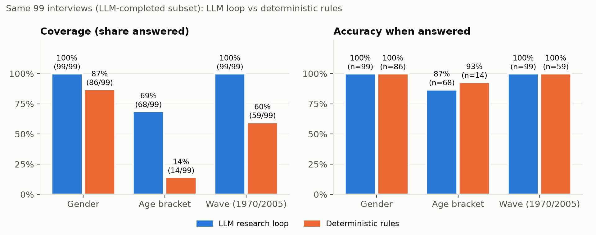
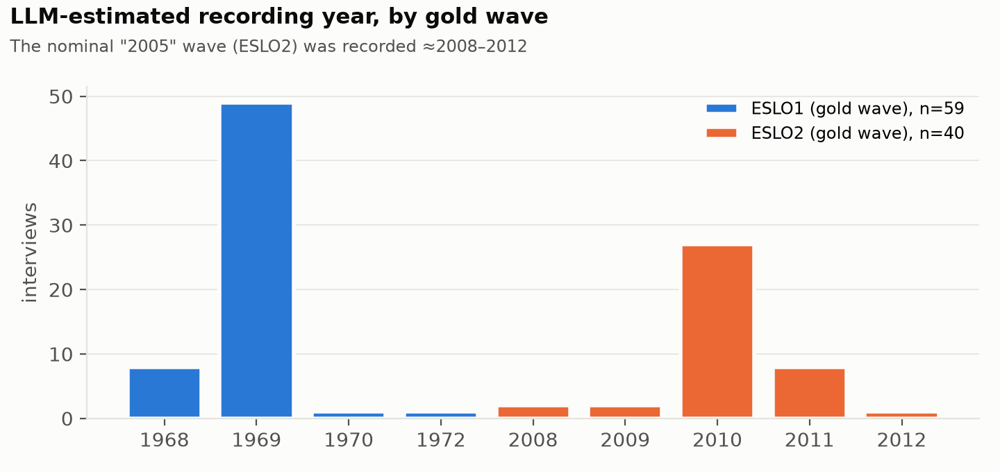
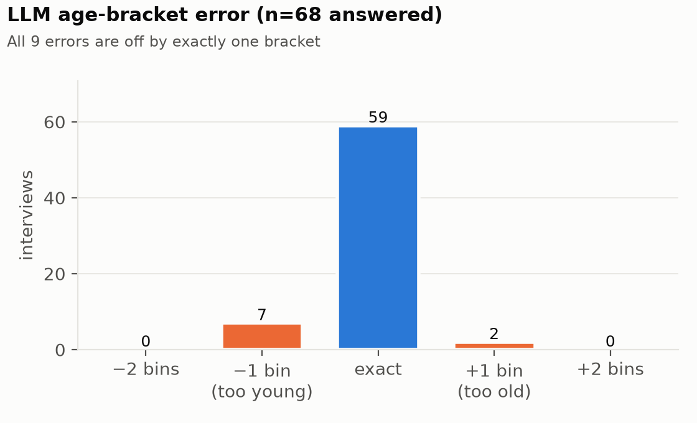
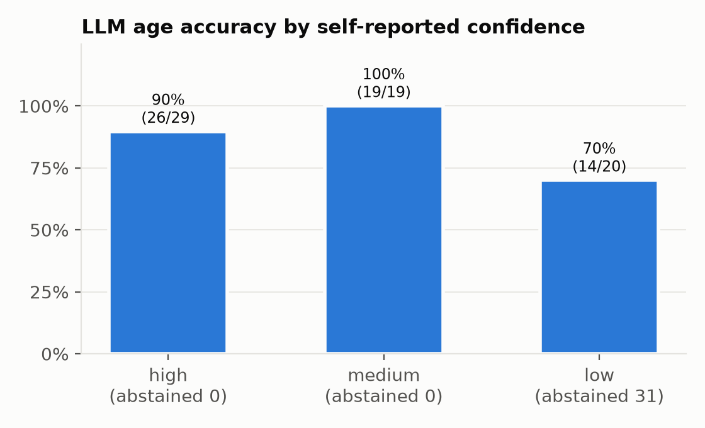
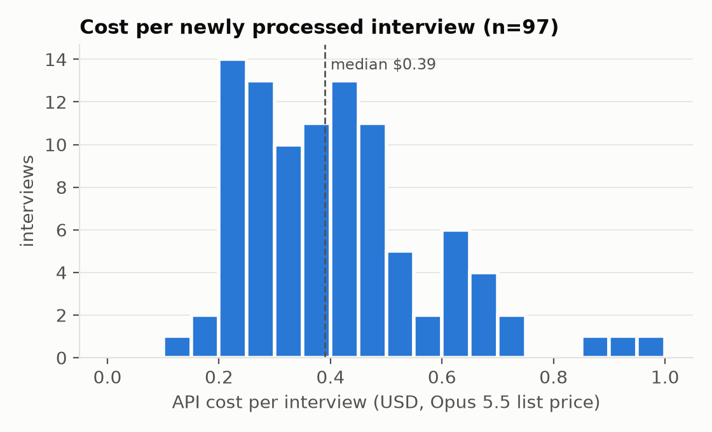

# Final research report: a ground-truth-blind LLM research loop for French interview metadata

**Date:** 2026-11-07 · **Frozen predictions:** `predictions_frozen.csv` (sha256 `947d81fa…`) · **Ground truth:** `~/Downloads/impactLab/lab_blind_speakers.tsv` (sha256 `0c40c163…`, outside the workspace, first opened after the freeze)

Each statement is tagged:
- **[M] Measured:** computed directly from data, logs or ground truth.
- **[I] Interpretation:** a reading of measured results.
- **[H] Hypothesis:** plausible, but not verified here.

---

## Executive summary

- **[M]** On the 99 interviews the LLM loop completed, it answered **gender for 99/99 (100% correct)** and the **wave label for 99/99 (100% correct)**. It answered **age for 68/99, 86.8% exact (95% CI 76.7–92.9%) and 100% within one bracket.**
- **[M]** On the same 99 interviews, the deterministic rules answered gender for 86, wave for 59 and age for 14, all at similar accuracy. **The LLM's gain is coverage, not precision:** age coverage went from 14% to 69%, wave from 60% to 100%.
- **[M]** Frozen predictions for all 192 interviews (LLM 99 + rules fallback 93):

  | Field | Accuracy when answered | Coverage |
  |---|---|---|
  | Gender | 99.5% | 96.4% |
  | Wave | 100% | 77.1% |
  | Age | 88.2% exact, 100% within one bracket | 39.6% |

- **[M]** The nominal year labels 1970 and 2005 are, in the ground truth, the waves **ESLO1 and ESLO2**. The LLM placed every ESLO2 interview it processed at **2008–2012**, mostly 2010. Evidence: speakers saying `on est en deux mille dix` (S035, S163, S192) and birth year plus stated age (S083: 2009–10). The early warning in CLAUDE.md was correct: "2005" is a wave label, not a recording year.
- **[M]** The run was **hard-stopped by the user** after 101 of 192 interviews:

  | Status | Interviews |
  |---|---|
  | Completed | 99 |
  | Failed | 3 |
  | Incomplete | 0 |
  | Unprocessed | 90 |

  Measured spend was **$42.18** ($39.76 full run, $2.42 pilot), with an upper-bound estimate of ≈ $43.15 including unrecorded calls. Cost was a median **$0.39 per interview**.
- **[M]** All 9 LLM age errors are adjacent-bracket errors. **[H]** At least 2 (S025, S163) reflect how the ground truth defines age, not model failure. Across the 22 rule-detected self-reports, gold age minus stated age is **+1 in 14 cases** (e.g. S163 says `j'ai vingt-neuf ans euh bientôt trente`; gold age is 30).



---

## 1. Research question and hypotheses

**Question.** From the transcripts alone, can we predict the interviewee's **age bracket** (0–9 … 90+), **gender** (female/male/unknown) and **interview year** (1970/2005/unknown), each with verbatim, speaker-attributed evidence and without seeing labels?

**Hypotheses (stated before evaluation, in PROMPT.md, TASKS.md and JOURNAL.md):**
- **H1.** A grounded, multi-step LLM loop (evidence collection → competing hypotheses → contradiction search → decision) raises coverage over deterministic rules without lowering precision.
- **H2.** The taxonomy {1970, 2005} is not a literal recording year. This was raised because of S035's `on est en deux mille dix`.
- **H3.** Abstaining (unknown) is preferable to forced guesses, and the model's confidence tracks accuracy.

## 2. Dataset

- **[M]** 192 TRS/XML transcripts (`impactLab/S001–S192.trs`), DTD from huma-num.
- **[M]** Speaker roles: `spk1` interviewer, `spk2` interviewee, and `other1–4` for other people present (95 interviews have at least one).
- **[M]** 217,371 turns, of which 44,375 have two speakers marked with `<Who nb=…/>`. That gives 434,376 speaker-attributed segments after splitting, about 18.2M characters.
- **[M]** Ground truth (opened after the freeze): `blind_id, age (integer), sex (f 100 / m 92), wave (ESLO1 117 / ESLO2 75), recording_id`.
- **[I]** The corpus is the two-wave *Enquêtes SocioLinguistiques à Orléans* (ESLO1 around 1968–71, ESLO2 from 2008). Place names such as Saint Marceau, Olivet and Saint-Jean-de-Braye match this.
- Transcripts contain personal life histories. All processing was local except the user-approved Anthropic API calls (see §8).

## 3. Methodology and research-loop architecture

```
TRS ─► segment parser (Sync/Who split) ─► SQLite
        │
        ├─► rules_v2.5 (deterministic): French number words, present anchors, era cues,
        │     first-person agreement, birth year + age → implied recording year
        │     └─► frozen rule predictions (outputs/predictions.csv)
        │
        └─► LLM loop (Opus 5.5, adaptive thinking, effort medium, strict JSON schema)
              1. chunk (≤100k chars, 10-segment overlap; nothing truncated)
              2. per-chunk evidence extraction: verbatim quote + seg_index + role + stance + about_interviewee
              3. validate every quote (substring of the cited segment, role match, in range); 1 corrective retry
              4. per-interview decision: competing hypotheses, counter-evidence, confidence, rationale
              5. merge: LLM decision if completed, otherwise labelled rules fallback
```

**Safeguards [M]:**
- No label access before the freeze.
- Plan-only by default; an approved budget and explicit interview IDs are required for paid calls.
- A disk cache keyed by (model, effort, prompt hash, chunk hash), so no call is ever repeated.
- A worst-case budget guard before each call.
- Provenance per interview: model, effort, prompt SHA-256, chunks and retries.

**Year policy:**
- `cohort_hypothesis` gives the nearest wave label.
- `interview_year` (strict) is left blank whenever evidence places the recording outside 1968–72 or 2004–06.
- `out_of_domain_year_flag` is kept as a separate field.

## 4. Technical implementation

| Component | File | Tests |
|---|---|---|
| Segment parser (Who/Sync) | `src/segments.py` | `tests/test_segments.py` |
| French numbers, years, ages, birth years (century-ambiguous) | `src/frnum.py` | `test_segments.py`, `test_rules_v2.py` |
| Deterministic predictor | `src/rules_v2.py` (v2.5) | `test_rules_v2.py` |
| Output validator (verbatim quotes) | `src/validate.py` | `test_validate.py` (+ mutation check) |
| Schemas, validator, chunker | `src/llm_schema.py` | `test_llm_schema.py` |
| Inference loop, cache, budget guard | `src/llm_infer.py` | `test_llm_infer.py` |
| Offline recovery after the hard stop | `src/recover.py` | `test_recover.py` |
| Merge and freeze | `src/merge_llm.py`, `src/freeze.py` | `test_merge_llm.py`, `test_freeze.py` |
| Post-freeze evaluator | `src/evaluate_full.py` | `test_evaluate_full.py` (synthetic only) |
| Charts and table | `src/make_charts.py`, `src/results_table.py` | visual inspection |

- **[M]** 96 unit tests pass. Prompts: `src/prompts/extract_v1.txt`, `decide_v3.txt`.
- Reproducibility snapshot: `REPRODUCIBILITY_SNAPSHOT.json`, with SHA-256 for code, prompts, tests, outputs and archive.
- Test-first was followed for most components. Exceptions, recorded in JOURNAL.md: `validate.py` and `freeze.py` had their tests written in the same step as the code.

## 5. Experimental results (ground-truth-blind phase)

- **[M] Pilot (5 interviews):**
  - 0 grounding errors in 11 of 11 chunks.
  - The first attempt hit an API 400 because nullable enums aren't accepted; fixed with sentinel values.
  - The stricter decision prompt (v3) left decisions stable.
- **[M] Full run:**
  - 285 calls, 7.41M input and 0.51M output tokens.
  - 11 calls needed a retry. 2 chunks still failed verbatim validation (S036, S099), and 1 chunk call failed live (S074, after a 24-minute stall).
- **[M] Agreement before evaluation:** the LLM never contradicted the rules where both answered. It added ages, genders and wave labels.
- **[M] Recording years estimated by the LLM:** 1968–1972 for all 59 ESLO1 interviews, and 2008–2012 for all 40 ESLO2 interviews (27 of them 2010).



## 6. Ground-truth evaluation

**Year scoring.** Year labels were scored with ESLO1 = "1970" and ESLO2 = "2005", an interpretation of the task's labels. The full table is `evaluation/results_table.md`, regenerated by `python -m src.results_table`.

| Field | Scope | n | Answered | Coverage | Acc. (answered) | 95% CI | Macro-F1 (answered) |
|---|---|---:|---:|---:|---:|---|---:|
| Gender | all 192 (frozen) | 192 | 185 | 96.4% | 99.5% | 97.0–99.9% | 99.5% |
| Gender | LLM subset: LLM | 99 | 99 | 100% | 100% | 96.3–100% | 100% |
| Gender | LLM subset: rules | 99 | 86 | 86.9% | 100% | — | 100% |
| Age | all 192 (frozen) | 192 | 76 | 39.6% | 88.2% (adjacent 100%) | — | 77.3% |
| Age | LLM subset: LLM | 99 | 68 | 68.7% | 86.8% (adjacent 100%) | 76.7–92.9% | 73.6% |
| Age | LLM subset: rules | 99 | 14 | 14.1% | 92.9% | 68.5–98.7% | 55.8% |
| Wave (cohort) | all 192 (frozen) | 192 | 148 | 77.1% | 100% | — | 100% |
| Wave (cohort) | LLM subset: LLM | 99 | 99 | 100% | 100% | 96.3–100% | 100% |
| Wave (cohort) | LLM subset: rules | 99 | 59 | 59.6% | 100% | 93.9–100% | 100% |
| Year (strict) | all 192 (frozen) | 192 | 107 | 55.7% | 100% | — | 100% |

### Confusion matrices [M]

| Field | Breakdown |
|---|---|
| Wave (cohort, all 192) | gold 1970 (117): 84 → 1970, 33 abstained · gold 2005 (75): 64 → 2005, 11 abstained · **no cross-errors** |
| Gender (all 192) | gold female (100): 96 → female, 1 → male (S118), 3 abstained · gold male (92): 88 → male, 4 abstained |
| Age (LLM) | 59 exact · 7 one bracket too young · 2 one bracket too old · 0 off by two or more |



### By evidence type and confidence [M]

**By source:**
- *LLM* (99 interviews): gender 100%, wave 100%, age 86.8%.
- *Rules fallback* (93): gender 98.8% at 92.5% coverage, wave 100% at 52.7%, age 100% at 8.6% (8/8).

**By the LLM's self-reported age confidence:**

| Confidence | Accuracy | Abstentions |
|---|---|---|
| High | 26/29 = 89.7% | 0 |
| Medium | 19/19 = 100% | 0 |
| Low | 14/20 = 70.0% | 31 of 51 |

**[I]** Low confidence is informative: it carries the lowest accuracy and most of the abstentions. Medium scoring above high is within noise at these sample sizes.



### Coverage, abstention and missing predictions [M]

- 0 missing predictions; all 192 IDs matched and no ground-truth values were unmapped.
- Abstention rates on all 192: gender 3.6%, wave 22.9%, age 60.4%.
- Strict year is 55.7% answered. All ESLO2 interviews processed by the LLM are blank there by design (out of domain).
- **Metric artifact:** strict-year macro-F1 is 50% on the LLM subset because the LLM answered only the 1970 class in strict mode.

### Selection bias from the incomplete run [M]

| Subset | ESLO1 share | Gender (f/m) |
|---|---|---|
| Processed (102) | 60% | 51/51 |
| Unprocessed (90) | 62% | 49/41 |

Age distributions are similar; the unprocessed set has slightly more people aged 70+.
- **[I]** Processing in ID order did not strongly skew wave or gender. The LLM-subset metrics are still estimated on IDs S001–S101, and ID could correlate with unobserved properties such as interviewer or transcription batch.
- Whole-corpus figures mix two methods (LLM and rules fallback), so they are not an estimate for either method alone.

## 7. Qualitative error analysis (French examples)

**Gold ages are one year above self-reports (the most common "error").**
- S163, interviewee, 535.6 s: `voilà on grandit j'ai j'ai j'ai vingt-neuf ans euh bientôt trente`. Also 443.5 s: `je suis né en quatre-vingt`. LLM: 20–29 (high). Gold: 30.
- S025: born 26 Dec 1930, recording dated February (seg 3376), project 2008–2010. LLM computes 77–79, so 70–79. Gold: 80.
- **[M]** Gold − stated age is +1 in 14 of 22 self-reports.
- **[H]** Gold age is computed as wave or recording year minus birth year, or at a later reference date. If so, 2 of the 9 LLM "errors" (S025, S163) would be correct under exact-age semantics. For the other 7, gold age minus one still falls in the same bracket.

**Ambiguous self-report.**
- S093, interviewee, 4148.2 s: `cinquante ans puisque j'ai soixante ans`. Both the LLM (high confidence) and the rules said 60–69. Gold: 52.
- **[I]** Either label noise, or the utterance isn't a current age (e.g. reported speech or a counterfactual). The transcript alone can't settle it.

**Indirect age chains (low confidence).**
- S003, S023, S067, S068, S069, S077: ages inferred from career length, children's ages or school-leaving age. All errors are one bracket off and marked `low`.
- **[I]** This is the intended behaviour for uncertain inference. A stricter policy (abstain on `low`) would raise precision to 45/48 = 93.8% and cut coverage to 48/99.

**Gender: a rule bug in the fallback (the only gender error).**
- S118 (rules fallback; the LLM never processed it). The interviewer says at 7.7 s `vous êtes née là-bas` (feminine), then `monsieur Pompidou`, `un pauvre monsieur qui s'appelle Ernest` (2953.9 s) and `le pauvre monsieur`.
- My address rule excluded only a determiner directly before *monsieur*. It missed adjective + noun and title + name, so references to third parties outvoted real feminine address.
- **[M]** Gold: female. **Fix (not applied; predictions are frozen):** exclude `monsieur` + capitalized name and `<det> <adj> monsieur`.

**Unsupported inference vs. incomplete verification.**
- S002: the decision inferred "married at 21" from seg 2115 (4280.1 s) `j'ai reçu ma dernière gifle à j'avais vingt et un ans`.
- My manual check first flagged this as over-interpretation. Seg 2117 (4285.7 s), `avant de me marier j'en étais à quatre jours de me marier`, confirms it. **The error was in my verification, not the model.**
- The stricter prompt (v3) then marked the age `low` because the deciding quote reached the decision step only as an extraction note. Gold: 38 → 30–39, correct.

**Rule false positives found during development (all fixed before freezing):**
- S059 `j'ai deux ans par le fait de plus…` and S092 `mais j'ai deux ans pfou` are durations, not ages.
- S007, 2751.2 s: `moi je suis né un vingt mars` is a birthday, not the year 1921.
- S111 `je suis de soixante dix-huit je vais avoir quatre-vingt-onze ans` means born **1878**, not 1978. This prompted the century-ambiguity logic. Gold: 91.

**Contradictions resolved correctly [M].**
- S035: `mon mari` was spoken by `other1` (the wife), not the interviewee. The LLM used roles correctly and predicted male. Gold: male.
- S004: the interviewer guesses `vous êtes né en quarante-sept ?`. The interviewee answers `non je suis né en quarante et un`. The rule kept the correction, not the question.

## 8. Cost and efficiency

| Item | Value | Basis |
|---|---|---|
| Full run (101 logged interviews, 97 newly paid) | **$39.76** | [M] cache usage × list price; equals the run ledger |
| Pilot + v3 re-check | $2.42 | [M] |
| Unrecorded: first pilot attempt (2 calls), call in flight at the stop | ≤ $0.97 | **estimate** |
| **Total** | **$42.18 measured; ≈ $43.15 upper bound** | not reconciled with Anthropic billing |
| Per newly processed interview | median $0.39, mean $0.41, range $0.15–$0.95 | [M] |
| Per correct LLM age answer | ≈ $0.67 | [I] $39.76 / 59 |
| Processing time | median 43 s, mean 62 s per interview; one stall of 24 min (S074) | [M] cache timestamps, approximate |
| Rules baseline | $0, about 20 s for all 192 | [M] |



- **[M]** The pre-run estimate of $53 for the full corpus was too low. The pilot recalibration to about $74 matched the observed rate ($0.41 × 192 ≈ $79).

## 9. Limitations and threats to validity

1. **Incomplete processing.** Only 99 of 192 interviews have LLM decisions. Whole-corpus metrics blend two methods, and the LLM-only estimate comes from the first 101 IDs.
2. **Label semantics.** Mapping ESLO1/ESLO2 to 1970/2005 is an interpretation. The year "accuracy" is really wave accuracy; strict recording-year accuracy can't be scored, since gold has no recording years.
3. **Age-definition mismatch [H].** Gold age is systematically about one year above self-reports. Exact-age accuracy depends on a definition the dataset doesn't document.
4. **Small denominators.** Wide confidence intervals for age by confidence level, and for rules-only age (n = 14).
5. **Development leakage risk (no labels, but in-sample).** Rule v2.5 and prompt v3 were tuned on pilot interviews (S001, S002, S010, S035, S163), which are also in the evaluation. No ground-truth labels were used, but those 5 interviews aren't held out.
6. **One model, one run, one effort level.** There's no variance estimate across seeds, models or effort levels, and sampling parameters can't be set on Opus 5.5.
7. **Grammatical gender ≠ gender identity.** The gender field measures transcriber spelling and how the interviewer addresses the speaker. Its 99.5% agreement with the dataset's `sex` field doesn't validate it as an identity measure.
8. **Verification limits.** Verbatim checks catch fabricated quotes, not misreadings. My own manual check made an error (S002).
9. **Data protection.** Transcript text went to the Anthropic API under the user's stated permission. Output files contain verbatim personal quotes and need corpus-level access control.

## 10. Discussion: is a frontier-model research loop necessary?

- **[M] Wave and gender:** deterministic rules already reach 100% precision on what they answer. The loop's value is coverage: wave 60% → 100%, gender 87% → 100% on the same 99 interviews.
- **[I]** Cheaper strategies would likely close much of that gap, for example a stronger rule set, or a small model only for interviews the rules leave unknown. Wave is almost trivially separable once era cues exist (1968–69 vs 2008–12).
- **[M] Age** is where the loop clearly helps: coverage 14% → 69% at 86.8% exact and 100% adjacent accuracy. It reasons over career length, births, schooling and events, which rules can't express.
- **[I]** Whether that requires a frontier model *and* a multi-step loop is untested. The loop's extra steps (verbatim validation, contradiction search) bought auditability: every claim traces to a timestamped quote. We haven't shown they bought accuracy.
- **[I] Recommendation:**
  - Rules first, for free (gender, wave, explicit ages).
  - An LLM only for unresolved fields: here, mostly age. At about $0.40 per interview, this would cut cost roughly in half.

## 11. Proposed comparison: a simple one-pass LLM baseline

**Design** (not run; needs approval):
- **Same input:** the full transcript per interview in one call (largest ≈ 70k tokens fits in context), with the same strict decision schema but no evidence-extraction step, no quote validation and no retry.
- **Arms:**
  - (a) one-pass Opus 5.5 at medium effort;
  - (b) one-pass Sonnet 5.5;
  - (c) one-pass Haiku 5.5;
  - (d) this loop (existing results).
- **Sample:** the 90 unprocessed interviews (S102–S192, never seen during development) as a clean held-out set, with a matched re-run of a random 30 from S001–S101 to check stability.
- **Metrics:** as in §6, plus the share of decisions whose cited segments actually support them (manual audit of 30 per arm), cost and latency.
- **Estimated cost** (one call per interview, about 40k input tokens and 2k output on average):

  | Arm | Model | Estimated cost (90 interviews) |
  |---|---|---|
  | (a) | Opus 5.5 | ≈ $18 |
  | (b) | Sonnet 5.5 | ≈ $9 |
  | (c) | Haiku 5.5 | ≈ $0.5 |

  Finishing the loop on the same 90 would cost about $37.
- **[H]** One-pass Opus will match the loop on gender and wave, and come within a few points on age accuracy. It will be worse on evidence traceability, and cost about half as much.

## 12. Conclusions and recommendations

1. **[M]** H1 is supported for coverage, with precision maintained:
   - gender 100% and wave 100% on 99 interviews;
   - age 86.8% exact and 100% adjacent at 69% coverage, against the rules' 14%.
2. **[M]** H2 is confirmed. The year labels are corpus waves (ESLO1/ESLO2). The "2005" wave was recorded around 2008–2012, and a strict reading of "interview year 2005" would be factually wrong for every ESLO2 interview processed.
3. **[M/I]** H3 is partly supported. Abstention keeps precision high, and low confidence signals lower accuracy. High and medium confidence aren't distinguishable at this sample size.
4. **Recommendations:**
   - **Labels:** ask the organizers to document the wave semantics and the definition of age; the +1-year pattern needs explaining.
   - **Full corpus:** finish the remaining 90 interviews with the cheaper hybrid (rules first, LLM for unresolved fields) or the one-pass design in §11. Use them as a held-out set.
   - **Rule fix:** correct the `monsieur` reference rule (S118) in a new version, evaluated only on new data.
   - **Audits:** keep the verbatim-grounding validator, and add a neighbour-segment audit to manual review.

---

### Artifacts

| What | Where |
|---|---|
| Frozen predictions and evidence | `predictions_frozen.csv`, `evidence_frozen.json` (read-only) |
| Reproducibility snapshot | `REPRODUCIBILITY_SNAPSHOT.json` |
| Evaluation | `evaluation/evaluation.json`, `evaluation/errors.csv`, `evaluation/results_table.{csv,md}` |
| Figures | `figures/fig1`–`fig5` (PNG, 200 dpi; palette validated for colour-vision deficiency) |
| LLM run records | `outputs/llm_full/` (cache, run.log, recovered_results.json, cost_time.json), `outputs/llm_pilot/` |
| Process log | `JOURNAL.md` (append-only), `TASKS.md`, `REPORT.md` |
